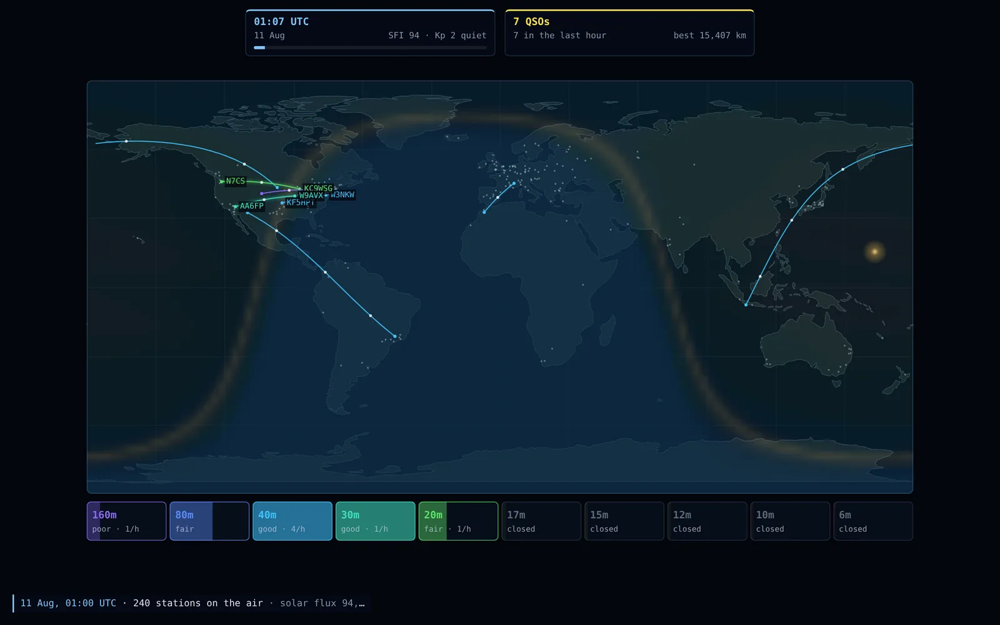
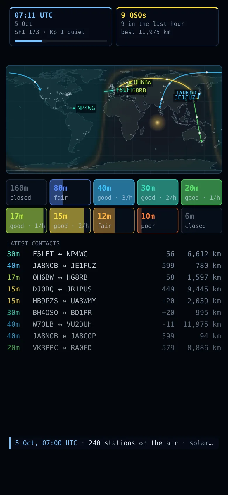

# Skywave

[](https://github.com/ali-raheem/skywave/actions/workflows/ci.yml) [](https://github.com/ali-raheem/skywave/actions/workflows/pages.yml)

**▶ Try it live: [shoryuken.me/skywave](https://shoryuken.me/skywave/)** · mirror on [GitHub Pages](https://ali-raheem.github.io/skywave/) · installable, works offline

<p align="center">
  <a href="https://shoryuken.me/skywave/"></a>
  <a href="https://shoryuken.me/skywave/"></a>
</p>

A world map of shortwave radio propagation. The sun crosses the map and the night side,
grey line and maximum usable frequency (MUF) follow it. A few hundred amateur radio stations
call CQ, pick a band that's open from where they are, and work whoever answers. Each contact
is drawn as a great-circle arc with its ionospheric reflection points. Solar flares, geomagnetic
storms and sporadic-E clouds come and go. Made for leaving on as a screensaver. Installable,
and works offline.

## What you're looking at

- **The map:** land and sea, the night side darkened, and the grey line (dawn and dusk)
  glowing amber. With the MUF map on, the colours show the highest band a 3,000 km hop could
  use from each point.
- **Arcs:** contacts, coloured by band. White dots mark F2-layer reflection points and pink
  ones sporadic-E. The newest three are labelled with callsigns.
- **Pink clouds** are sporadic-E, **green glow** near the poles is the aurora during a
  geomagnetic storm, and a **white flash** on the sunlit side is a solar flare.
- **The band strip:** each band's share of a fixed set of long test paths it can carry,
  graded closed, poor, fair or good, plus its contacts in the last hour.
- **The feed** narrates the run: bands opening and closing, new distance records,
  grey-line and 6m sporadic-E contacts, flares, storms and a daily tally.

## The model

- **The sun:** declination and subsolar longitude from the date and UTC time give the solar
  zenith angle anywhere.
- **The F2 layer:** foF2 follows the zenith angle (softened through dawn and dusk) and
  the 10.7 cm solar flux. It has an equatorial anomaly, and polar regions are weaker,
  more so in a storm.
- **The MUF:** for a hop of length *d* off a 300 km layer, the secant law gives MUF =
  foF2 × sec *i*. A path takes as many hops as it needs (each up to 3,800 km) and must be
  under the MUF at every reflection point. Skip zones fall out of the geometry.
- **Absorption:** the D layer absorbs as (cos χ)^1.1 / *f*², rising with solar flux and
  flares, with a little residual night absorption. The auroral oval absorbs during
  storms, and the grey line cuts absorption.
- **The signal budget:** spreading loss, ground-reflection loss per hop, a penalty near
  the MUF, station power and antenna gain (beams only on 20m and up; small antennas
  lose a lot on 160m and 80m), against ITU rural man-made noise. FT8 works at −20 dB,
  CW at −3 and SSB at +8, with ±4 dB of fading per contact.
- **Sporadic-E:** dense patches 110 km up, on summer days at mid-latitudes. They reflect
  one hop of up to 2,200 km at foEs × sec *i*, which opens 10m and 6m.

It's a toy next to VOACAP, but the physics points the same way, so bands open and close
at the right times of day, season and solar cycle.

Stations cluster around real centres of amateur activity, with the right ITU prefixes
and Maidenhead locators. The suffixes are random, so any match with a real callsign is a
coincidence.

The coastlines are Natural Earth 1:110m (public domain), via the world-atlas TopoJSON
build. `scripts/make_map.py` turns them into `js/land.js`.

## Controls

Space pause · +/− speed (½× to 8×; 1× is two minutes a second) · N new run · B band
conditions · L log · S settings · U MUF map · K callsigns · M sound · F fullscreen ·
H hide the interface. The URL carries `#seed=…`, so a link replays the same run.

## Run it

```bash
npm run serve   # python3 -m http.server 8080
npm test        # node --test, no dependencies
```
